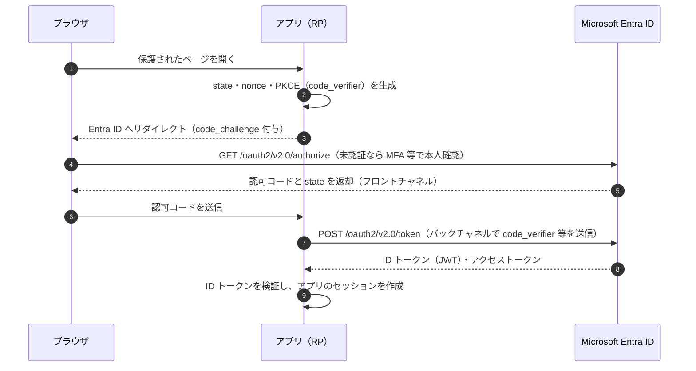
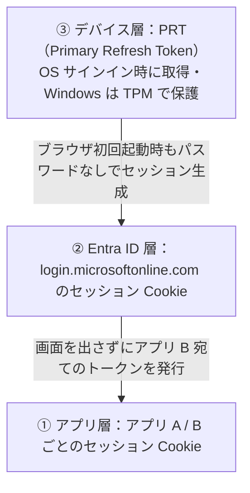

# SSO × Microsoft Entra ID

- 基準日：2026-11-08

## 概要

シングルサインオン（SSO）は、本人確認（認証）を **IdP（Identity Provider）** 1か所に集約し、一度のサインインで複数のアプリを使えるようにする仕組み。各アプリはパスワードを一切受け取らず、Entra ID が署名したトークン（**ID トークン** または **SAML アサーション**）を検証してログインさせる。

Microsoft Entra ID（旧 Azure AD）は、社内 LAN 向けの Active Directory（Kerberos / LDAP）とは別物のクラウド ID 基盤であり、インターネット越しの HTTP ベース（OpenID Connect / SAML 2.0）で SaaS や Web・モバイルアプリの認証を担う。

## 認証・認可と IdP / SP

SSO は「**認証（あなたは誰か）**」の結果を共有する仕組み。使うプロトコルによって登場人物の呼び名が異なる。

| 役割 | 一般名 | OpenID Connect での呼称 | SAML 2.0 での呼称 | 具体例 |
| --- | --- | --- | --- | --- |
| 本人確認をする側 | **IdP** | OpenID Provider（OP） | Identity Provider（IdP） | Microsoft Entra ID |
| トークンを検証しログインさせる側 | **アプリ** | Relying Party（RP）/ クライアント | Service Provider（SP） | Salesforce、自社 Web アプリ |
| 本人確認の証明書類 | **トークン** | **ID トークン**（JWT / JSON） | **SAML アサーション**（XML） | ― |

## アプリの登録とエンタープライズ アプリケーション

Entra ID にアプリを繋ぐ際、1つのアプリは**設計図**と**テナント内の実体**の2種類のオブジェクトで管理される[^1]。

| オブジェクト | 管理センターの場所 | 役割・持つ設定 | 作られる数 |
| --- | --- | --- | --- |
| **アプリケーション オブジェクト** | アプリの登録 | **設計図**（クライアント ID、リダイレクト URI、API 権限、シークレット・証明書） | 開発元テナントに1つ |
| **サービス プリンシパル** | エンタープライズ アプリケーション | **そのテナントでの実体**（利用ユーザー割り当て、SAML 設定、条件付きアクセス、SCIM プロビジョニング） | 利用するテナントごとに1つ |

- **自社開発アプリ**：「アプリの登録」で作ると、同じテナントにサービス プリンシパルも自動生成される
- **既存 SaaS（ギャラリーアプリ）**：追加するとサービス プリンシパル（エンタープライズ アプリケーション）だけが自テナントに作られる

## OpenID Connect による SSO（第一候補）

OAuth 2.0 の上に **ID トークン（JWT）** を載せた標準[^2]。新規開発の Web アプリ・SPA・モバイルで第一候補になる。

### 認可コードフロー＋PKCE

ブラウザ経由（フロントチャネル）では使い捨ての「認可コード」だけを渡し、実際のトークンはアプリサーバーと Entra ID の直接通信（バックチャネル）で受け取る[^2][^5]。



- **`state`（CSRF 対策）**：認可要求時とコールバック時で一致を確認するランダム値
- **`nonce`（リプレイ対策）**：ID トークン内に埋め込まれて返るランダム値
- **PKCE（認可コード横取り対策[^5]）**：要求時にハッシュ値（`code_challenge`）、トークン交換時に元の値（`code_verifier`）を渡す

### ID トークンのクレームと検証ルール

```json
{
  "iss": "https://login.microsoftonline.com/11111111-2222-3333-4444-555555555555/v2.0",
  "aud": "aaaaaaaa-bbbb-cccc-dddd-eeeeeeeeeeee",
  "tid": "11111111-2222-3333-4444-555555555555",
  "oid": "99999999-8888-7777-6666-555555555555",
  "sub": "AAAAAAAAAAAAAAAAAAAAAIkzqFVrSaSaFHy782bbtaQ",
  "preferred_username": "taro@contoso.com",
  "nonce": "b6c2...",
  "exp": 1794099600
}
```

| クレーム | 意味 | アプリ側での検証・扱い[^2] |
| --- | --- | --- |
| `iss` / `tid` | 発行者 URL / テナント ID | 許可したテナントの Entra ID が発行したものか確認する |
| `aud` | 宛先（自分のクライアント ID） | 自アプリ宛てか確認する（他アプリ向けトークンの流用拒否） |
| `exp` / `nonce` | 有効期限 / リプレイ防止値 | 期限内かつ要求時の `nonce` と一致するか確認する |
| **`oid`（または `sub`）** | **不変のユーザー識別子** | **`tid` + `oid` をアプリ DB のユーザー識別キーにする**（`oid` はテナント内共通 GUID、`sub` はアプリごとに異なる値） |
| `preferred_username` / `email` | 表示用 UPN / メールアドレス | **表示専用**（識別や認可に使わない） |

> [!WARNING]
> `email` や `preferred_username` をアプリ側のユーザー識別キーにしてはいけない[^2]。ユーザーの改名や、マルチテナント環境で別テナントから同名メールアドレスを名乗る攻撃（nOAuth）によって他人のアカウントに乗っ取られる。必ず不変 GUID である **`tid` + `oid`** を使う。

## SAML 2.0 による SSO（既存 SaaS 向け）

XML 形式の **SAML アサーション** に署名し、ブラウザの自動送信フォーム（HTTP-POST）でアプリの ACS URL に渡す方式[^3]。OIDC 未対応の既存 SaaS で使う。

| 観点 | OpenID Connect[^2] | SAML 2.0[^3] |
| --- | --- | --- |
| **トークン形式・経路** | JWT（JSON）／バックチャネルで取得 | XML／**ブラウザ経由の POST（フロントチャネル）のみ** |
| **事前交換する設定** | クライアント ID＋リダイレクト URI | Entity ID（識別子）＋ACS URL（応答 URL）＋**署名用証明書** |
| **署名鍵の更新** | Discovery（JWKS）から自動取得 | **証明書（既定3年）の期限前に手動更新**（メタデータ URL 自動取得対応アプリを除く） |
| **API 呼び出し・モバイル** | 同一フローでアクセストークン取得可・相性良 | 対象外・不向き |

- **SP 起点と IdP 起点**：アプリ側から `AuthnRequest` を送って始める **SP 起点**では、応答の `InResponseTo` で要求との照合ができる。マイアプリのタイル等からいきなり応答を POST する **IdP 起点**は要求照合ができずリプレイ攻撃に弱いため、マイアプリにも「サインオン URL」を設定して SP 起点で動かすのが推奨される[^3]

## 3層のセッションと PRT（なぜ2回目から聞かれないか）

2つ目のアプリでパスワードを聞かれないのは、セッションが3層に分かれているため[^4]。



| 層 | 実体と有効期間 | 役割（切れたときの挙動） |
| --- | --- | --- |
| **① アプリ層** | 各アプリが自ドメインに発行する Cookie | 切れると Entra ID へリダイレクトされるが、② が生きていれば画面なしで即座に再ログインできる |
| **② Entra ID 層** | `login.microsoftonline.com` の Cookie（非永続24時間 / 永続90日） | アプリ B に初めてアクセスした際、画面を出さずにアプリ B 宛てのトークンを発行する（**Web SSO の正体**） |
| **③ デバイス層** | **PRT**（有効90日・4時間ごとに自動更新）[^4] | Entra 参加 PC や macOS Platform SSO で OS サインイン時に取得。OS のブローカーがブラウザやアプリに引き継ぐため初回からパスワード不要になり、「会社管理の準拠デバイスか」の証明も担う |

## 注意点・運用の急所

SSO は入口を1つに集約するため、**入口を守れば全体が守られ、入口が破られれば全アプリが突破される**。

- **条件付きアクセスとフィッシング耐性 MFA**：トークン発行時にユーザー・デバイス準拠状態・場所・リスクを評価する関所（P1 以上）。偽サイトで中継する AiTM フィッシングは SMS やプッシュ通知も突破するため、パスキー（FIDO2）・Windows Hello・証明書認証を要求し、レガシー認証と不要なデバイスコードフローをブロックする
- **SCIM 2.0 自動プロビジョニング**：SSO は「本人確認」だけで、退職時に SaaS 側のアカウントを消す機能はない。初回ログイン時にアカウントを作る JIT だけでなく SCIM（約40分周期）を併用し、Entra ID での無効化を各 SaaS に連動させる
- **SAML 署名証明書の期限切れ（既定3年）**：自動更新されないため、期限切れは該当 SaaS の SSO 全面停止に直結する[^3]。通知先を共有アドレスにし、ロールオーバー手順を備える
- **ハイブリッド構成（社内 AD DS 併用）の認証方式**：クラウド側で完結し社内障害時も止まらない **パスワード ハッシュ同期（PHS）** が基本推奨。AD FS 残置はオンプレ署名鍵の窃取で全ユーザーを偽造される（Golden SAML）ため Entra ID 直接認証へ移行する

## 参考

[^1]: Microsoft Learn. *Application and service principal objects in Microsoft Entra ID.* https://learn.microsoft.com/entra/identity-platform/app-objects-and-service-principals
[^2]: Microsoft Learn. *OpenID Connect on the Microsoft identity platform & ID token claims.* https://learn.microsoft.com/entra/identity-platform/v2-protocols-oidc
[^3]: Microsoft Learn. *Single sign-on SAML protocol & certificate management.* https://learn.microsoft.com/entra/identity-platform/single-sign-on-saml-protocol
[^4]: Microsoft Learn. *Understanding Primary Refresh Token (PRT).* https://learn.microsoft.com/entra/identity/devices/concept-primary-refresh-token
[^5]: RFC 9700: *Best Current Practice for OAuth 2.0 Security.* https://www.rfc-editor.org/rfc/rfc9700
