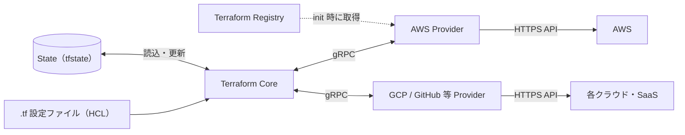

# Terraform

- 基準日：2026-11-08（Terraform 1.17.1 時点）

## 概要

Terraform は、サーバー・ネットワーク・DNS・SaaS などの「インフラのあるべき姿」を **HCL** で宣言的に記述し、現在の状態との差分を計算して各サービスの API で作成・変更・削除を行う IaC（Infrastructure as Code）ツール。

サービスごとの API の違いをプラグイン（**Provider**）に閉じ込めることで、単一クラウド専用の IaC（CloudFormation / Bicep 等）では扱えないマルチクラウドや SaaS（GitHub・Cloudflare・Datadog 等）を1つの言語・1つのワークフローで横断管理できる。

## Core・Provider・State（全体構造）



| 構成要素 | 実体 | 役割 |
| --- | --- | --- |
| **Terraform Core** | `terraform` コマンド本体 | 設定と State を突き合わせて依存グラフと実行計画を作り、Provider に指示を出す。特定クラウドの知識は持たない |
| **Provider** | `.terraform/` に取得される別バイナリ | 各サービスの API を呼んで CRUD を行うプラグイン（Core と gRPC 通信）。バージョンとハッシュは `.terraform.lock.hcl` で固定し Git 管理する |
| **State** | `terraform.tfstate`（JSON） | 「コード上の定義（例：`aws_s3_bucket.logs`）」と「現実のリソース ID」の対応表および最新属性の記録 |

## HCL と主要ブロック

### ブロックの種類と参照方法

設定は `.tf` ファイルに HCL（HashiCorp Configuration Language）で書く。同一ディレクトリ内の `.tf` はすべて合算して読まれる（`main.tf` / `variables.tf` / `outputs.tf` への分割は人間の整理用）。

| ブロック | 役割 | コード内での参照方法 |
| --- | --- | --- |
| `terraform` | 本体・Provider のバージョン制約、State の保存先（`backend`） | ― |
| `provider` | Provider の設定（リージョン、共通タグ等） | `provider = <名>.<alias>` |
| `resource` | **作成・管理する**インフラ部品 | `<型>.<名前>.<属性>` |
| `data` | **読み取るだけ**の既存情報（AMI ID、既存 VPC 等） | `data.<型>.<名前>.<属性>` |
| `variable` / `locals` | 外部からの入力変数 / 内部で使い回す計算値 | `var.<名前>` / `local.<名前>` |
| `output` | 外部や親モジュールへ公開する出力値 | ― |
| `module` | `.tf` 一式をまとめた再利用部品（子モジュール）の呼び出し | `module.<名前>.<出力名>` |

### 最小コード例（`local` / `random` Provider）

クラウドアカウントなしで手元実行できる構成。属性参照による依存順序の自動推論と `for_each` の動きが確認できる。

```hcl
terraform {
  required_version = ">= 1.10"
  required_providers {
    local  = { source = "hashicorp/local",  version = "~> 2.9" }
    random = { source = "hashicorp/random", version = "~> 3.9" }
  }
}

variable "names" {
  type    = set(string)
  default = ["alice", "bob"]
}

resource "random_pet" "suffix" {
  length = 2
}

resource "local_file" "greeting" {
  for_each = var.names
  filename = "${path.module}/out/${each.key}.txt"
  # random_pet.suffix.id を参照しているため、自動的に suffix → greeting の順で作られる
  content  = "Hello, ${each.key}! (id: ${random_pet.suffix.id})\n"
}
```

## `init → plan → apply` の動き

### 基本コマンドと内部処理

```bash
terraform init              # Provider / モジュール取得・Backend 接続・lock ファイル作成
terraform plan -out=tfplan  # 差分計画を計算・保存（実物は変えない）
terraform apply tfplan      # 保存した計画どおりに API 実行・State 更新
```

1. **リフレッシュ**：State に載っている各リソースの最新状態を Provider 経由で問い合わせ、手作業変更によるずれ（**ドリフト**）を検出する
2. **依存グラフの構築**：属性の参照関係から作成順序（有向グラフ）を自動推論する（削除時は逆順）
3. **差分計算**：コードのあるべき姿と現実を比較し、各リソースに対する操作を決定する
4. **並列実行と State 更新**：`apply` 時に依存のないリソースを並列（既定10並列）で処理し、結果を State に書き込む

### `plan` の差分記号

| 記号 | 意味 | 注意点 |
| --- | --- | --- |
| `+` / `-` | 作成 / 削除 | `(known after apply)` は実際に作るまでクラウド側で値が決まらない属性 |
| `~` | その場で更新（in-place update） | リソースを再作成せずに設定変更できる |
| `-/+` | **置き換え（削除して再作成）** | その場更新できない属性変更で発生（`# forces replacement`） |

> [!WARNING]
> `plan` に **`-/+`（置き換え）** が出た場合、既存リソースが一度削除されてから作り直される。RDS 等のデータ消失やサービス停止に直結するため、レビュー時に最優先で確認する。

## State 管理と機密情報

### State の役割と分割・ロック

**State に載っていないリソースは Terraform にとって存在しない**[^2]。コードから定義を消したときに「State にはあるがコードにない → 削除すべき」と判定するために不可欠になる。

- **リモート Backend とロック**：チーム運用では S3（1.11 で `use_lockfile = true` のネイティブロックが GA、DynamoDB ロックは非推奨[^3]）・GCS・HCP Terraform 等に置き、同時 `apply` による破損をロックで防ぐ
- **State の分割**：1つの State に全リソースを入れると `plan` が遅くなり、ミスの影響範囲（blast radius）も広がる。環境（dev / prod）× 層（network / db / app）でディレクトリと State を分ける

### 機密情報の扱い（State に秘密を残さない方法）

通常のリソース属性値は **State に平文で記録される**[^2]ため、用途に応じて保護機能を使い分ける。

| 機能 | 導入 | 画面出力 | plan / State ファイル | 用途 |
| --- | --- | --- | --- | --- |
| `sensitive = true` | 0.14〜 | 隠す | **平文で残る** | 画面ログへの露出防止のみ（Backend 側の暗号化と IAM 制限が必須） |
| **`ephemeral`（変数・リソース）**[^1] | 1.10〜 | 隠す | **残らない** | 一時トークン発行や Secrets Manager からの読み取り |
| **write-only 属性（`*_wo`）**[^1] | 1.11〜 | ― | **残らない** | DB パスワード等を State に一切保存せず API に渡す（変更時は `*_wo_version` を増やす） |

## Terraform vs OpenTofu と他ツール比較

| ツール | 位置づけ・使い分け |
| --- | --- |
| **Terraform（HashiCorp / IBM）** | 1.6 以降は BSL 1.1 ライセンス（自社インフラ管理なら制限なし）。HCP Terraform、Stacks、Actions、Terraform Policy（1.17 GA）を使う場合の選択[^1] |
| **OpenTofu（CNCF Sandbox）**[^4] | BSL 変更時に分岐した MPL 2.0 の OSS フォーク。State ファイル自体の暗号化、Provider の `for_each`、`-exclude` などの独自機能を持つ |
| **Ansible** | 競合ではなく**補完関係**（VM やネットワーク作成は Terraform、OS 内部のパッケージ・設定管理は Ansible） |
| **CloudFormation / Bicep / Pulumi** | 単一クラウド完結で State 管理をクラウド側に任せたいなら CFn / Bicep、TypeScript / Go 等の汎用言語で書きたいなら Pulumi（CDKTF は 2025-12 に開発終了） |

## 注意点・運用の急所

- **複数リソースは `count` より `for_each`**：`count` は配列番号（`[0]`, `[1]`）で管理するため、途中要素を消すと後続の番号がずれて全部作り直しになる。`count` は `var.enabled ? 1 : 0` の有無切り替えに絞る[^1]
- **宣言的リファクタリング（`moved` / `import` / `removed`）**：リソース改名だけで `apply` すると削除＆再作成になる。`moved`（State 上の住所変更）、`import`（既存リソース取り込み。1.14 の `terraform query` で一括検索も可）、`removed`（実物を残して管理解除）をコードに書いて `plan` で確かめる[^1]
- **本番リソースの保護**：本番 DB 等には `lifecycle { prevent_destroy = true }` で削除計画をエラー化し、無停止置き換えには `create_before_destroy = true` を使う

## 参考

[^1]: HashiCorp. *Terraform Language & CLI Documentation.* https://developer.hashicorp.com/terraform/language
[^2]: HashiCorp. *Terraform State.* https://developer.hashicorp.com/terraform/language/state
[^3]: HashiCorp. *Backend Type: s3 (`use_lockfile`).* https://developer.hashicorp.com/terraform/language/backend/s3
[^4]: OpenTofu Project. *OpenTofu Documentation.* https://opentofu.org/
