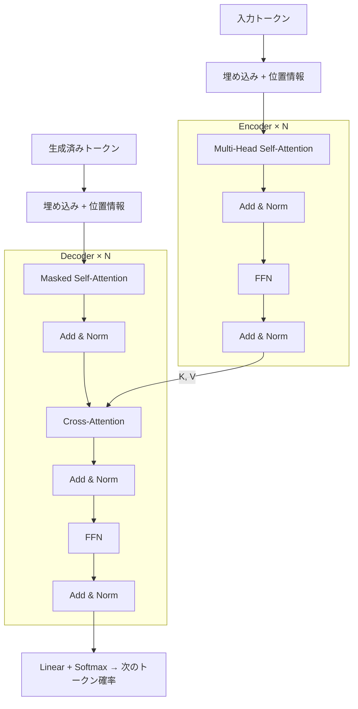

# Transformer

- 基準日：2026-11-08

## 概要

Transformer は、文中の全トークン同士の関係を一度に計算する **Self-Attention** を軸にしたニューラルネットワーク（2017年 *"Attention Is All You Need"*[^1]）。

従来の系列モデル（RNN / LSTM）のような「先頭から1単語ずつ順番に処理する再帰構造」を廃し、GPU での**並列学習**と**長距離の文脈把握**を両立した。言語だけでなく、トークン列に変換できる画像・音声・分子構造まで扱う基盤アーキテクチャとなっている。

| 層の種類 | 1層の計算量 | 逐次処理の回数 | 任意の2トークン間の距離 |
| --- | --- | --- | --- |
| RNN | $O(n \cdot d^2)$ | $O(n)$（前の時刻を待つ） | $O(n)$（長文で情報が劣化） |
| **Self-Attention** | $O(n^2 \cdot d)$ | **$O(1)$（全トークン並列）** | **$O(1)$（文頭と文末を直結）** |

> [!NOTE]
> $n$ は系列長、$d$ は表現の次元数[^1]。逐次処理 $O(1)$ で並列化でき、距離 $O(1)$ で文頭と文末を直結できる引き換えに、**計算量とメモリが系列長の2乗（$n^2$）に比例する**のが最大のトレードオフになる。

## 全体アーキテクチャ（Encoder-Decoder）

原論文（機械翻訳向け）は、入力文を文脈表現に変える **Encoder** と、それを参照して1トークンずつ生成する **Decoder** の2部構成[^1]。すべての層で入出力の形が $n \times d_{\text{model}}$ と同じため、同じブロックを何段でも積める。

- **Self-Attention / Cross-Attention**：同じ系列内のトークン同士で文脈を集めるのが Self、Decoder（Q）が Encoder 出力（K, V）を参照するのが Cross
- **FFN（Feed-Forward Network）**：Attention の後に各トークンへ独立に適用する2層の全結合層。Attention が「トークン間の情報混合」、FFN が「各トークン内の変換」を担い、パラメータの大半は FFN にある
- **Add & Norm（残差接続と正規化）**：入力 $x$ をそのまま足し戻して勾配の近道を作り、正規化（LayerNorm / RMSNorm）で値の暴走を防ぐ

## トークン埋め込みと位置エンコーディング

テキストはまずサブワード（BPE 等）のトークンに分割し、各トークン ID を埋め込み行列で $d_{\text{model}}$ 次元（原論文は 512 次元）のベクトルに変換する[^1]。

### なぜ位置情報が必要か

Self-Attention はトークン集合に対する一括計算であり、**それ自体には語順の概念がない**（「犬が猫を追う」と「猫が犬を追う」が同じ集合になる）。そのため各位置に固有の情報を注入する。

- **正弦波位置エンコーディング（原論文[^1]）**：次元ごとに周波数の異なる sin / cos 波を埋め込みベクトルに加算する
- **RoPE：回転位置埋め込み（現代 LLM の主流[^2]）**：位置ベクトルを足す代わりに、Query と Key のベクトルを位置に応じた角度だけ回転させる。内積が「2トークンの相対距離」だけに依存する形になり、長い文脈へ拡張しやすい

## Attention（Query・Key・Value と計算式）

### Query・Key・Value の役割

Attention は「**あいまいな辞書引き**」[^5]。入力ベクトル $X$ に学習重み行列 $W^Q, W^K, W^V$ を掛けて3種類のベクトルを作り、Query と全 Key の類似度に応じて全 Value を重み付き合成する。

| ベクトル | 作られ方 | 役割 | 辞書引きでの対応 |
| --- | --- | --- | --- |
| **Query ($Q$)** | $X W^Q$ | 自分は何を探しているか | 検索キーワード |
| **Key ($K$)** | $X W^K$ | 自分はどんな情報を持っているか | 各記事のタイトル |
| **Value ($V$)** | $X W^V$ | 実際に渡す情報の中身 | 各記事の本文 |

### Scaled Dot-Product Attention の式と計算ステップ

$$
\mathrm{Attention}(Q, K, V) = \mathrm{softmax}\!\left(\frac{QK^{\top}}{\sqrt{d_k}}\right) V
$$

1. **類似度計算（$QK^{\top}$）**：全 Query–Key ペアの内積（似ているほど大きい）を求める
2. **スケーリング（$\div \sqrt{d_k}$）**：次元 $d_k$ が大きいと内積の分散が $d_k$ 倍に広がり、**softmax が 0 か 1 に張り付いて勾配が消える**のを防ぐため $\sqrt{d_k}$ で割って分散を 1 に戻す[^1]
3. **正規化（$\mathrm{softmax}$）**：行ごとに合計 1 の「注意の重み」に変換する
4. **重み付き和（$\times V$）**：注意の重みで全トークンの Value を混ぜ合わせる

### 3トークンでの数値計算例（$d_k = 2$）

トークン1（$q_1 = [1, 0]$）が全トークンから情報を集める場合：

| トークン | Key ($k$) | Value ($v$) | ① 内積 $q_1 \cdot k$ | ② $\div \sqrt{2}$ | ③ softmax（重み） |
| --- | --- | --- | --- | --- | --- |
| **1** | $[1, 0]$ | $[1, 0]$ | $1$ | $0.707$ | **$0.401$** |
| **2** | $[0, 1]$ | $[0, 1]$ | $0$ | $0$ | $0.198$ |
| **3** | $[1, 1]$ | $[0.5, 0.5]$ | $1$ | $0.707$ | **$0.401$** |

4. **重み付き和**：$0.401[1, 0] + 0.198[0, 1] + 0.401[0.5, 0.5] = [0.602, 0.398]$（$q_1$ に近い Key を持つトークン 1・3 の Value が強く反映される）

## Multi-Head・マスク・KV キャッシュ

### Multi-Head Attention

1種類の Attention だけでは「主語と動詞」「代名詞の指示先」「隣接語」など異なる性質の関係を同時に捉えにくい。次元を $h$ 個（原論文は $512 \div 8 = 64$ 次元×8ヘッド）に分割して並列に Attention を計算し、最後に連結する[^1]。1ヘッドあたりの次元を縮めるため、総計算量は単一ヘッドとほぼ同じ。

### 学習時の並列化（Causal マスク）と推論時の KV キャッシュ

- **学習時（Teacher Forcing + Causal マスク）**：Decoder に正解文を1つ右にずらして一括入力する。未来位置のスコアを $-\infty$（重み 0）にする下三角マスクを掛けることで、先読みを防ぎつつ**全位置の次トークン予測を1回の順伝播で並列計算**できる[^1]
- **推論時（自己回帰生成 + KV キャッシュ）**：推論時は正解がないため1トークンずつ生成して入力に足す。過去トークンの $K, V$ は毎ステップ同じなのでメモリにキャッシュして再計算を省く（長文・多接続時はこの KV キャッシュのメモリ消費が最大のボトルネックになる）

## 3つの系統と現代 LLM での進化

### 用途別の3系統

| 系統 | 構造 | 代表モデル | 主な用途 |
| --- | --- | --- | --- |
| **Encoder のみ** | 双方向 Attention（穴埋め事前学習） | BERT, DeBERTa | 文書分類、固有表現抽出、検索用埋め込み |
| **Decoder のみ** | Causal マスクのみ（次トークン予測） | GPT, LLaMA, Qwen, DeepSeek | 文章・コード生成、対話、推論（**現在の主流**） |
| **Encoder-Decoder** | 原論文と同じ | T5, BART | 翻訳、要約、形式変換 |

### 原論文（2017）から現代 LLM への主な改良

| 箇所 | 原論文（2017）[^1] | 現代の主流 | ねらい |
| --- | --- | --- | --- |
| **全体構造** | Encoder-Decoder | **Decoder-only** | 構造の単純化・ラベルなしデータでの大規模化 |
| **正規化** | Post-LN + LayerNorm | **Pre-LN + RMSNorm** | 深い層での学習安定化・計算の軽量化 |
| **位置情報** | 正弦波を加算 | **RoPE**（Q・K を回転）[^2] | 相対位置の表現・長文脈への拡張 |
| **FFN** | Dense + ReLU | **MoE**（一部専門家のみ活性化）+ **SwiGLU** | 計算量を抑えたまま総パラメータ容量を拡大 |
| **Attention** | MHA / 素直な行列積 | **GQA・MLA** / **FlashAttention**[^3] | KV キャッシュ削減 / GPU SRAM 内完結による高速化 |

## 注意点・運用の急所

- **系列長の2乗（$O(n^2)$）の計算コスト**：文脈長が2倍になると Attention の計算量は4倍になり、KV キャッシュも肥大化する
- **SSM・線形 Attention とのハイブリッド**：Mamba 等の状態空間モデル（SSM）[^4]は計算量 $O(n)$ だが、文脈内の正確なコピーや検索が苦手。そのため大半の層を線形 Attention / SSM にし、一部の層に通常の Attention を残すハイブリッド構成（Jamba, Qwen3-Next 等）が広がっている

## 参考

[^1]: Vaswani, A. et al. (2017). *Attention Is All You Need.* NeurIPS 2017. https://arxiv.org/abs/1706.03762
[^2]: Su, J. et al. (2021). *RoFormer: Enhanced Transformer with Rotary Position Embedding (RoPE).* https://arxiv.org/abs/2104.09864
[^3]: Dao, T. et al. (2022). *FlashAttention: Fast and Memory-Efficient Exact Attention with IO-Awareness.* https://arxiv.org/abs/2205.14135
[^4]: Gu, A. & Dao, T. (2023). *Mamba: Linear-Time Sequence Modeling with Selective State Spaces.* https://arxiv.org/abs/2312.00752
[^5]: Jay Alammar. *The Illustrated Transformer.* https://jalammar.github.io/illustrated-transformer/
