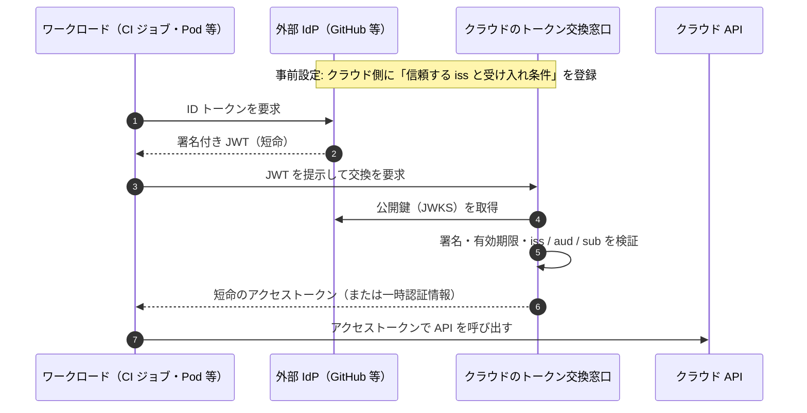

# Workload Identity Federation

- 基準日：2026-11-08

## 概要

Workload Identity Federation（WIF）は、クラウド外のプログラム（CI/CD ジョブ、別クラウドの VM、Kubernetes の Pod など）が、**長期の秘密鍵を一切持たずに**クラウド API を呼ぶための認証の仕組み（プログラム版 SSO）。

従来のサービスアカウントキー（GCP）やアクセスキー（AWS）のような長期鍵の事前配布をやめ、実行環境が発行する短命の ID トークンをクラウド側が検証し、短命のアクセストークンへ交換する。

| 観点 | 従来の長期鍵（SA キー・アクセスキー） | Workload Identity Federation |
| --- | --- | --- |
| 事前共有するもの | 秘密鍵（CI の Secrets 等に保管） | **公開情報のみ**（信頼する発行者 URL と受け入れ条件） |
| 有効期限 | 無期限・長期 | 数分〜数時間（実行ごとに発行） |
| 漏えい時の影響 | 無効化するまでどこからでも悪用可能 | 期限切れで自動失効 |
| 権限制御・監査の粒度 | 鍵単位 | トークンの属性（リポジトリ・ブランチ・環境など）単位 |

## JWT（JSON Web Token）

WIF でやり取りされる ID トークンの実体は JWT。

### 3部構造と署名の役割

`.` で区切られた3つのパートから成る文字列[^1]。

```text
<ヘッダー>.<ペイロード>.<署名>
```

ヘッダーとペイロードは Base64URL エンコードされているだけで誰でも読めるため、**改ざん防止と発行元の証明はすべて「署名」が担う**。

| パート | 入っている内容 | 役割 |
| --- | --- | --- |
| **ヘッダー** | 署名アルゴリズム（`RS256` 等）、署名鍵の ID（`kid`） | どの公開鍵・方式で検証するかを伝える |
| **ペイロード** | **クレーム**（トークンが主張する属性の JSON） | 誰が・誰に・誰について発行したかを表す |
| **署名** | ヘッダー＋ペイロードを発行者の**秘密鍵**で署名した値 | 中身の改ざん検知・発行元の証明 |

### 主要クレーム（ペイロードの中身）

| クレーム | 意味 | 値の例（GitHub Actions） | WIF での用途 |
| --- | --- | --- | --- |
| `iss`（issuer） | 誰が発行したか | `https://token.actions.githubusercontent.com` | 信頼する IdP かの確認・公開鍵の取得先 |
| `aud`（audience） | 誰宛てか | `sts.amazonaws.com` | 自クラウド宛てかの確認（他サービス用の流用防止） |
| `sub`（subject） | 誰についてか | `repo:octo-org/octo-repo:ref:refs/heads/main` | 実行元（リポジトリ・ブランチ等）の絞り込み |
| `exp` / `iat` | 有効期限 / 発行時刻 | UNIX 時刻 | 期限切れトークンの拒否 |
| 独自クレーム | 実行環境の属性 | `repository_id`, `repository_owner_id`, `environment` 等[^5] | 不変 ID や環境名での細かな条件絞り込み |

## OIDC Discovery と公開鍵検証

JWT の署名を検証するには発行者の**公開鍵**が必要になる。OpenID Connect（OIDC）では、発行者 URL（`iss`）配下の決まったパスに設定情報と公開鍵一覧（JWKS）を公開する規約（OIDC Discovery）がある。

```text
<iss>/.well-known/openid-configuration
  └─ "jwks_uri": "<iss>/.well-known/jwks"  ← 公開鍵の一覧（JWKS: JSON Web Key Set）
```

### なぜ事前に秘密鍵を配らなくてよいか

1. 外部 IdP は自分の**秘密鍵**で JWT に署名する（秘密鍵は IdP の外に一切出ない）
2. クラウド側はトークンの `iss` から **公開鍵（JWKS）** を自動取得し、ヘッダーの `kid` と一致する公開鍵で署名を検証する
3. 公開鍵は誰でも取得してよい公開情報なので、クラウドと外部環境の間に秘密情報を事前登録する必要がない

## トークン交換と認証フロー

外部 IdP の JWT はそのままではクラウド API に使えないため、クラウド側の交換窓口（STS 等）でクラウド専用の短命アクセストークンへ引き換える[^1]。

### 全体シーケンス



### 信頼関係の3点照合

クラウド側がトークンを受け入れる際、署名と有効期限に加えて次の3点を照合する。この条件設定が事実上の「鍵」になる。

| 確認項目 | クレーム | 検証内容 | 条件が緩い場合のリスク |
| --- | --- | --- | --- |
| **発行者** | `iss` | 信頼登録した IdP の URL と一致するか | 無関係な IdP のトークンを通す |
| **宛先** | `aud` | 自クラウドのこの設定宛ての値か | 別サービス向けに発行されたトークンを流用される |
| **実行主体** | `sub` 等 | 許可した組織・リポジトリ・ブランチ・Pod か | **同じ IdP を使う他人のジョブを通す** |

> [!WARNING]
> GitHub Actions や GitLab.com などのマルチテナント IdP は、**世界中の全ユーザーに対して同じ `iss` でトークンを発行する**。`iss` だけで信頼すると世界中の誰のジョブでも通ってしまうため、`sub` や不変の組織・リポジトリ ID による絞り込みが必須になる[^2][^3]。

## GCP・AWS・Azure の構成対応

名称や交換 API は異なるが、構成要素の対応関係はすべて同じ。

| 役割 | Google Cloud[^2] | AWS[^3] | Microsoft Entra ID（Azure）[^4] |
| --- | --- | --- | --- |
| **信頼の登録先** | Workload Identity プール＋プロバイダー | IAM OIDC プロバイダー＋IAM ロール | アプリ登録 / マネージド ID の FIC |
| **受け入れ条件** | CEL 式の属性条件＋IAM 付与先 | ロール信頼ポリシーの `Condition` | `iss`・`sub`・`aud` の完全一致（Flexible FIC で式対応） |
| **交換窓口** | STS（RFC 8693 Token Exchange[^1]） | STS `AssumeRoleWithWebIdentity` | トークン EP（RFC 7523 `client_assertion`） |
| **返却されるもの** | フェデレーテッドトークン（または SA トークン） | 一時認証情報（キー・シークレット・セッショントークン） | Entra ID アクセストークン |
| **権限の付与方法** | 外部 ID（`principalSet://` 等）へ直接 IAM 付与、または SA なりすまし | IAM ロールの許可ポリシー | Azure RBAC のロール割り当て |

> [!NOTE]
> - **Kubernetes（GKE / EKS / AKS）**：クラスタ自身が OIDC 発行者となり、Pod の ServiceAccount トークン（`sub = system:serviceaccount:<ns>:<sa>`）を同じ仕組みでクラウド権限に交換する。
> - **Workforce Identity Federation（GCP）との違い**：Workload はプログラム向け（プロジェクト単位）、Workforce は従業員などの「人」向け（組織単位）[^2]。

## GitHub Actions → AWS の設定例

### 1. GitHub Actions が発行する JWT ペイロード

ワークフローに `permissions: id-token: write` を付けるとジョブごとに発行される[^5]。

```json
{
  "iss": "https://token.actions.githubusercontent.com",
  "aud": "sts.amazonaws.com",
  "sub": "repo:octo-org/octo-repo:ref:refs/heads/main",
  "repository_id": "456789",
  "repository_owner_id": "123456",
  "ref": "refs/heads/main",
  "exp": 1794096300
}
```

### 2. AWS IAM ロールの信頼ポリシー

`octo-org/octo-repo` の `main` ブランチからの実行のみを許可する設定[^3]。ワークフロー側では `aws-actions/configure-aws-credentials` にロール ARN を渡すだけで、シークレットなしに認証が完了する。

```json
{
  "Version": "2012-10-17",
  "Statement": [
    {
      "Effect": "Allow",
      "Principal": {
        "Federated": "arn:aws:iam::111122223333:oidc-provider/token.actions.githubusercontent.com"
      },
      "Action": "sts:AssumeRoleWithWebIdentity",
      "Condition": {
        "StringEquals": {
          "token.actions.githubusercontent.com:aud": "sts.amazonaws.com",
          "token.actions.githubusercontent.com:sub": "repo:octo-org/octo-repo:ref:refs/heads/main"
        }
      }
    }
  ]
}
```

## 注意点・運用の急所

- **可変の名前ではなく不変の数値 ID で絞る**：組織名・リポジトリ名は削除・改名後に第三者が再取得して同じ `sub` を作れる場合がある。`repository_id` / `repository_owner_id` を条件に含める。なお GitHub は 2026-07-15 以降の新規・改名リポジトリから `sub` 自体に不変 ID（`repo:org@123456/repo@456789:...`）を含める形式を既定化したため、クラウド側の条件と形式を合わせる[^5]
- **GitHub Environment 指定時の `sub` 変化**：ジョブに `environment: production` を指定すると、`sub` はブランチ形式ではなく `repo:org/repo:environment:production` に切り替わる[^5]
- **信頼設定の変更権限＝全権限**：プール・プロバイダー・信頼ポリシー・FIC を変更できる人は任意の外部 ID を通せるため、変更可能ロールを最小限に絞る[^2]
- **CI 内の悪意あるコード実行**：改ざんされたサードパーティ Action 等がジョブ内で動けばその場で権限を使われる。Action のコミットハッシュ固定、フォーク PR での権限付与禁止、移行後の長期鍵作成禁止ポリシーを併用する

## 参考

[^1]: RFC 7519 (JWT) / RFC 8693: *OAuth 2.0 Token Exchange.* https://www.rfc-editor.org/rfc/rfc8693
[^2]: Google Cloud. *Workload Identity Federation & Best practices.* https://docs.cloud.google.com/iam/docs/workload-identity-federation
[^3]: AWS. *Create a role for OpenID Connect federation.* https://docs.aws.amazon.com/IAM/latest/UserGuide/id_roles_create_for-idp_oidc.html
[^4]: Microsoft Entra. *Workload identity federation.* https://learn.microsoft.com/entra/workload-id/workload-identity-federation
[^5]: GitHub Docs. *OpenID Connect reference (claims & immutable sub).* https://docs.github.com/en/actions/reference/security/oidc
